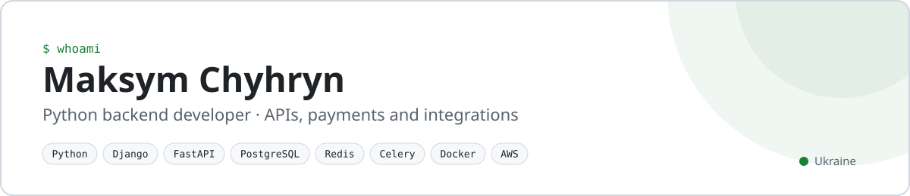
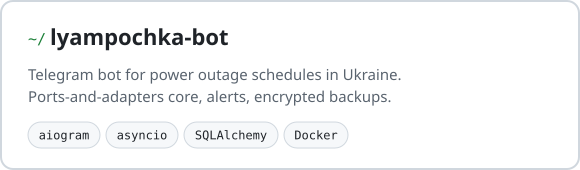

  <a href="https://www.linkedin.com/in/maksym-chyhryn/">LinkedIn</a> ·
  <a href="https://t.me/chyhryn_m">Telegram @chyhryn_m</a> ·
  <a href="mailto:macks.chigrin@gmail.com">macks.chigrin@gmail.com</a>

### Projects

  
  
  

### Recently shipped

<!-- recent_start -->
- [BudgetTrackerApp](https://github.com/Sn1kls/BudgetTrackerApp): [chore: portfolio cleanup (repo structure, backend fixes, CI, README)](https://github.com/Sn1kls/BudgetTrackerApp/pull/1), 30 Oct 2026
- [lyampochka-bot](https://github.com/Sn1kls/lyampochka-bot): [docs: rewrite the README in English](https://github.com/Sn1kls/lyampochka-bot/pull/26), 30 Oct 2026
- [lyampochka-bot](https://github.com/Sn1kls/lyampochka-bot): [chore: version 0.2.0 and the commit hash in /status](https://github.com/Sn1kls/lyampochka-bot/pull/24), 19 Oct 2026
- [LibraryDjango](https://github.com/Sn1kls/LibraryDjango): [fix (backend): language format, delete unused serializer](https://github.com/Sn1kls/LibraryDjango/pull/2), 10 Feb 2025
- [LibraryDjango](https://github.com/Sn1kls/LibraryDjango): [Add library app](https://github.com/Sn1kls/LibraryDjango/pull/1), 09 Feb 2025
<!-- recent_end -->

This list updates itself every day from my merged pull requests in public repos ([build_readme.py](build_readme.py), run by GitHub Actions).
